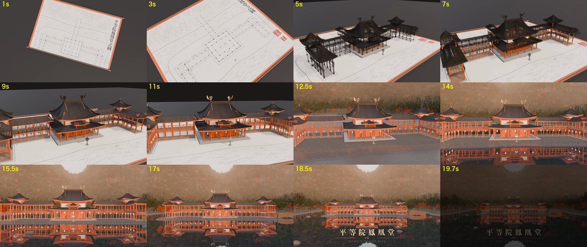
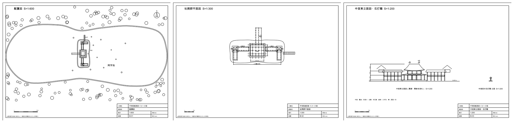
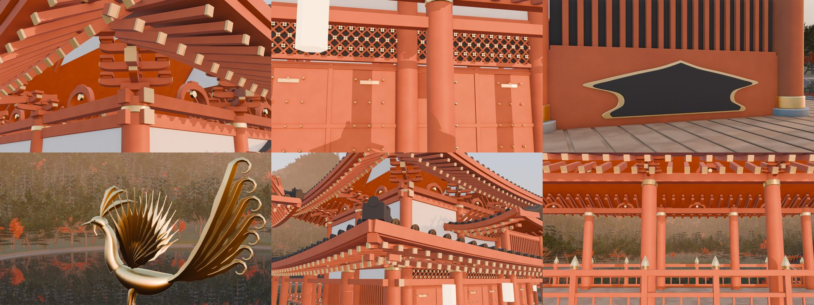
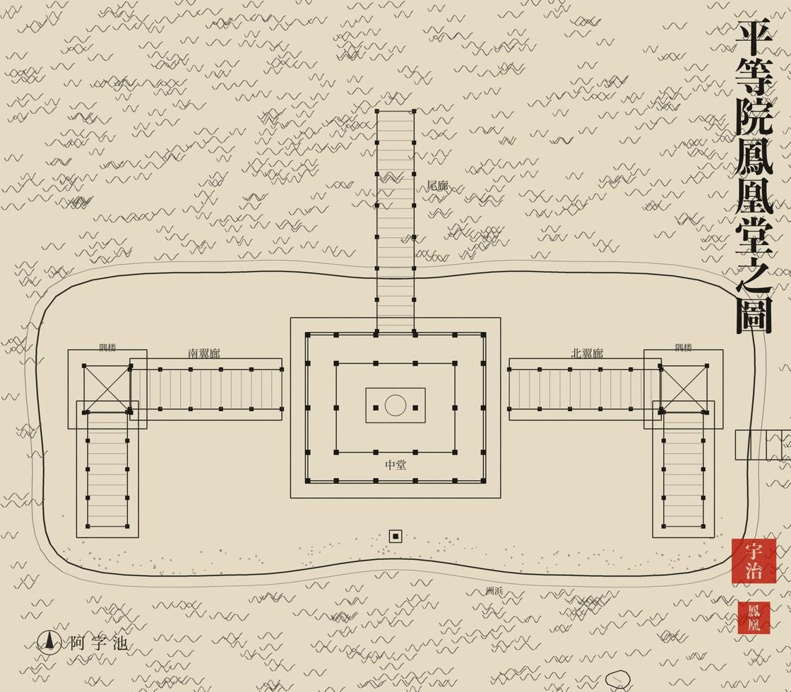

# 平等院鳳凰堂 — CAD 図面から Blender 動画まで

平等院鳳凰堂をイメージした **CAD 図面（DXF 3 枚）** と、それをもとにした **20 秒の 3D 動画** を、すべて Python のコードで作ります。3D モデル・テクスチャ・音の外部素材は使っていません。

巻物に描いた墨の配置図から、部材の線が墨線のまま立ち上がり、床 → 柱 → 壁・欄間・組物 → 屋根 → 高欄・鳳凰の順に部材ごとに実体化します。最後は干潟に水が満ちて、正面から引いた全景で終わります。



> 実測図ではありません。一般的な外観をもとにした作図です。

## できるもの

| 出力 | 中身 |
|---|---|
| `build/dxf/*.dxf` | 配置図 1:600・社殿群平面図 1:300・中堂東立面図 1:200（A2、単位 mm、表題欄つき） |
| `build/byodoin.blend` | シーン一式（Blender 5.2） |
| `build/frames/f_0025.png`〜`f_0504.png` | 本編 480 コマ（1920×1080、24fps） |
| `build/audio/byodoin_mix.wav` | 雅楽風の BGM（笙・篳篥・龍笛・楽太鼓・鉦鼓）と効果音（梵鐘・水音・秋の虫など）、20 秒 |
| `build/byodoin.mp4` | 完成版の動画（20 秒・音あり） |



細部も部材から組み立てています。組物（曲面の斗・繰形の肘木・尾垂木・蟇股）、欄間（菱格子に花菱）、格狭間、扉の乳金物、二軒の垂木と巴紋の軒丸瓦、隅棟と鬼瓦、擬宝珠の高欄、鳳凰（曲面の胴と首、一枚ずつの羽根）など。



## 動作環境

- macOS（Apple M5・メモリ 32GB で確認）
- [Blender](https://www.blender.org/) 5.2（`blender` にパスを通す。4.x では確認していません）
- Python 3.11 以上と `pip install -r requirements.txt`
- ffmpeg

文字には macOS の標準フォント（凸版文久見出し明朝・ヒラギノ明朝・Didot）を使います。ほかの環境では、`BYODOIN_FONT_TITLE`・`BYODOIN_FONT_MINCHO`・`BYODOIN_FONT_SERIF` にフォントファイルのパスを指定してください（`fonts.py`）。

## 使い方

```sh
pip install -r requirements.txt
make all       # 図面・巻物の図・音・タイトル・シーン（合わせて 1 分ほど）
make test      # 要所の 5 コマを半分の解像度で build/test/ に描いて確かめる
make render    # 本番 480 コマ
make video     # build/byodoin.mp4
```

`make render` は、低い優先度で Blender を 1 本ずつ動かし、30 コマごとに 45 秒休ませます（`tools/render_chunks.sh`）。M5 の MacBook で約 1 時間 40 分かかりました。途中で止めても、描き終えたコマは飛ばして続きから描きます。

そのほかの確認用の道具です。

- `make dxf-preview`：DXF を PNG にして `build/dxf/` に置く
- `make camera`：カメラの動きを数値で確かめる（視線の回転と、その変化の最大値）
- `blender -b build/byodoin.blend -P tools/shot.py -- 470 out.png 7.4 -8.2 6.2 3.6 -4.8 7.7 40 100`：好きな位置から寄りを 1 枚撮る

## しくみ

**寸法は 1 か所に。** `geometry.py` に柱の位置・屋根の高さ・池の形などを置き、DXF（`cad/`）・巻物の図（`drawing/`）・3D シーン（`scene/`）が全部これを読みます。だから巻物の線と、そこから立ち上がる墨線の位置が一致します。



**部材ごとの実体化。** 建物は 5 つの段（基壇・床／柱／壁・欄間・組物／屋根／高欄・鳳凰・灯籠）の別オブジェクトに分けています。各部材の頂点に「中堂からの距離＋少しの揺らぎ」を `ord` として持たせ、段ごとにキー打ちした `prog` を超えた部材から、シェーダーで順に現れます（`scene/materials.py` の `ord_alpha`）。

**墨線は部材そのもの。** 墨線は部材と同じメッシュを共有し、ジオメトリノードで辺を細い管にしたものです（`scene/wire.py`）。同じ `ord` を読むので、部材が現れた瞬間にその部材の線が消えます。

**カメラは一本の曲線。** 制御点を時間で重み付けした Catmull-Rom でつなぎ、2 コマおきにキーを打っています（`scene/camera.py`）。ズームなし・往復なしで、視線の回転量の変化は 1 コマあたり 0.1° 以下です。

**音も合成。** 笙の合竹（自由リードの倍音）、篳篥の塩梅（音の入りのずり上げ）、龍笛の息、楽太鼓・鉦鼓・梵鐘・りんを NumPy で作り、区切りのコマに合わせて置いています（`sound/make_audio.py`）。

## ファイル構成

```
geometry.py          共通の寸法データ（単位 m、x=東 y=北 z=上）
fonts.py             フォントの探し方
cad/                 DXF 図面の生成と PNG プレビュー
drawing/             巻物に貼る墨の配置図
scene/               Blender のシーン（build.py が入口）
  common.py            時間割り・補助関数
  materials.py         マテリアル（すべてプロシージャル）
  mesh.py              メッシュを組み立てる道具（押し出し・ロフト・羽根）
  roof.py              照り屋根
  hall.py              鳳凰堂の部材
  wire.py              墨線
  scroll.py            巻物
  terrain.py           地形・池・水面
  trees.py             樹木（葉を 1 枚ずつ付けた原型を並べる）
  environment.py       空・霞・光
  camera.py            カメラ
sound/               BGM と効果音
finish/              タイトルと、動画への書き出し
tools/               分割レンダリング・確認用の道具
```

## ライセンス

MIT

このリポジトリのコードは [Claude Code](https://claude.com/claude-code)（Claude Opus 5.5）で書きました。
